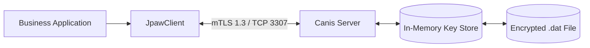

## CANIS - KMS

See the [documentation index](docs/README.md) for guides and research evidence, and the
[unified backlog](joss-backlog.md) for every open task and phase checkpoint.

**CANIS** is a custom-built Key Management System (KMS) designed to manage public and private keys
for applications through the official Java client. The client and server communicate through an
internal Redis-inspired protocol called **CANISP (Canis Protocol)**. CANISP is not RESP-compatible
and is not the application-facing API.

Applications generating text files containing sensitive information leverage CANIS for encryption
and decryption. Before saving such files to disk, these applications encrypt them using a public key
stored in CANIS. Later, when processing shared encrypted files, authenticated applications ask CANIS
to decrypt data with the stored private key, keeping private keys on the server.
The official client exposes file envelope helpers so applications can encrypt shared files and
decrypt them by asking CANIS to unwrap the file key.

In addition to its key management functionality, CANIS provides a key-value store where the key is
an arbitrary identifier, and the value is an object containing attributes such as name, public key,
and private key. The current store encrypts these entries in a `.dat` file; its lifecycle and
durability limits are documented in [docs/rsa-key-lifecycle.md](docs/rsa-key-lifecycle.md).
The CANISP protocol supports various data types, including arrays of maps, strings, integers, and
individual maps, enabling flexible and structured data communication between the official client
and server.
The current protocol is documented in [docs/canisp-protocol.md](docs/canisp-protocol.md).
Threat model and deployment assumptions are documented in
[docs/threat-model.md](docs/threat-model.md).
Client package publishing steps are documented in
[docs/client-package-deploy.md](docs/client-package-deploy.md).
Client package usage and validation rules are documented in
[docs/client-package.md](docs/client-package.md).
The [JOSS-01 research evaluation](docs/research/joss01-method.md) documents a reproducible
synthetic-data test of the current shared trust boundary and its limitations.
The [reviewer guide](docs/reviewer-guide.md) gives clean-checkout build steps, a
reproducible producer-to-recipient TLS example, expected output, and operational limits.
See [contribution guidance](CONTRIBUTING.md) for ordinary issues and support,
and [security reporting](SECURITY.md) for suspected vulnerabilities.
#### Key Features:

1. **Socket Communication:**
    - The server listens for incoming connections from client applications over a specified port.
    - Utilizes TCP/IP for reliable communication, ensuring data integrity and order.

2. **Custom Protocol (CANISP):**
    - The CANISP protocol defines a structured internal format for data transmission between the
      CANIS server and official client.
    - Application developers should use the official Java client instead of writing raw CANISP
      socket messages.
    - Supports the following data types:
        - **Arrays of Maps:** Allows clients to send multiple key-value pairs in a structured
          format.
            - Example: `|a>|ms>name:john|mi>age:25|ms>city:poa|ms>state:rs`
        - **Strings:** Simple text messages can be sent.
            - Example: `|s>Hello World`
        - **Integers:** Numeric values can be transmitted.
            - Example: `|i>100`
        - **Maps:** Key-value pairs can be sent as a single unit.
            - Example: `|ms>name:john|mi>age:25|ms>city:poa|ms>state:rs`

3. **Key-Value Store:**
    - The server maintains an in-memory key-value store to temporarily hold registered application
      data.
    - Each application can register its name and associated data, which is stored in a structured
      format.

4. **Persistence:**
    - Key creation and deletion persist an encrypted `.dat` database. Normal startup requires an
      existing valid database; creating a new one requires the explicit `--init-db` command.
    - Recovery requires the matching database and externally provisioned master-key file. Writes
      retain the verified old database in a recovery path before installing the new file; an
      interrupted two-move sequence and filesystem crash durability remain operational limits.
      See the [CODE-01 integrity evidence](docs/code01-integrity.md).

5. **Command Handling:**
    - The server processes incoming CANISP commands from authenticated clients, allowing for
      operations such as:
        - Registering a new application with its associated data.
        - Retrieving application data based on the registered name.
        - Updating or deleting application data as needed.

**Technologies Used:**

- Programming Language: Java
- Networking: JSSE TLS 1.3 sockets with client certificate authentication
- Data Storage: File I/O for `.dat` encrypted file persistence

#### Architecture


### Prerequisites
- Java 21+
- Maven

### Testing & Running

For a long-running server and client, supply these settings from protected
external configuration. The password values below are placeholders, not
working credentials; automated tests generate their own fixtures and do not
need this setup. Follow the [reviewer guide](docs/reviewer-guide.md) for an
executable example.

```bash
# server port
export CANIS_PORT=3307;
# client server host
export CANIS_SERVER_HOST=localhost;
# client server port
export CANIS_SERVER_PORT=3307;
# service username
export CANIS_USERNAME=admin
# service password: supply from protected external configuration
# client PKCS#12 identity and trusted-server stores (separate from server TLS settings)
export CANIS_CLIENT_TLS_KEYSTORE=/secure/path/client.p12;
export CANIS_CLIENT_TLS_KEYSTORE_PASSWORD=...;
export CANIS_CLIENT_TLS_TRUSTSTORE=/secure/path/servers.p12;
export CANIS_CLIENT_TLS_TRUSTSTORE_PASSWORD=...;
# optional CANIS_SERVICE_CREDENTIALS: supply from protected external configuration
# path to the externally provisioned database master-key file
export CANIS_SECRET_KEY=/my/secret/location/secret.txt;
# PKCS#12 server identity containing its certificate chain and private key
export CANIS_TLS_KEYSTORE=/my/secret/location/server.p12;
# PKCS#12 truststore containing trusted client certificates or issuing CA certificates
export CANIS_TLS_TRUSTSTORE=/my/secret/location/clients.p12;
# Supply both store passwords from an external secret manager or protected environment
export CANIS_TLS_KEYSTORE_PASSWORD=...;
export CANIS_TLS_TRUSTSTORE_PASSWORD=...;

# run tests
mvn test

# build executable jar
mvn package

# start server
java -jar server/target/canis-jar-with-dependencies.jar
```

For a new installation, explicitly initialize the encrypted database once after provisioning
`CANIS_SECRET_KEY` and the other server settings:

```bash
java -jar server/target/canis-jar-with-dependencies.jar --init-db
java -jar server/target/canis-jar-with-dependencies.jar
```

Initialization refuses an existing `db.dat`. Normal startup refuses a missing or invalid database;
it never assumes that a missing file means a new installation. Run both commands from the same
working directory because the database path is `db.dat` relative to that directory. If a previously
used database is missing, restore it together with its matching master key from protected backups.
See [database recovery requirements](docs/master-key.md) before attempting initialization.

The server fails startup if TLS material is missing or invalid. It accepts TLS 1.3 only and
requires a trusted client certificate before CANISP login. Protect both PKCS#12 files and their
passwords with operating-system access controls; do not commit them or include them in images.
The server certificate must identify the DNS name clients use. Rotate certificates before expiry.

The database master key and an explicitly initialized database must already exist when the server
starts. CANIS validates the key format and filesystem permissions and authenticates the database
before listening. It never generates a replacement during normal operation.
See [database master-key requirements](docs/master-key.md) for provisioning, permissions, and
recovery. Keep the key and encrypted database backed up as a matching pair.

Both endpoints allow only the TLS 1.3 suites `TLS_AES_128_GCM_SHA256`,
`TLS_AES_256_GCM_SHA384`, and `TLS_CHACHA20_POLY1305_SHA256`. Each endpoint enables only
approved suites already enabled by its Java TLS provider. Provider-disabled suites stay disabled;
if no approved suite remains, setup fails closed with a sanitized configuration error. Peers must
share at least one enabled approved suite. The server uses PKIX validation for client
certificates, and the official client uses PKIX validation plus hostname verification for the
server certificate. There is no certificate-validation bypass or plaintext fallback. Cipher
suite selection is fixed in the application and has no environment-variable override.

The official `JpawClient` uses TLS 1.3 with client-certificate authentication, trusted server
certificate validation, and hostname verification. Configure its PKCS#12 identity and trust stores
with the `CANIS_CLIENT_TLS_*` variables above. The client fails closed and has no plaintext
fallback. Keep client and server certificates and passwords external to source control.
